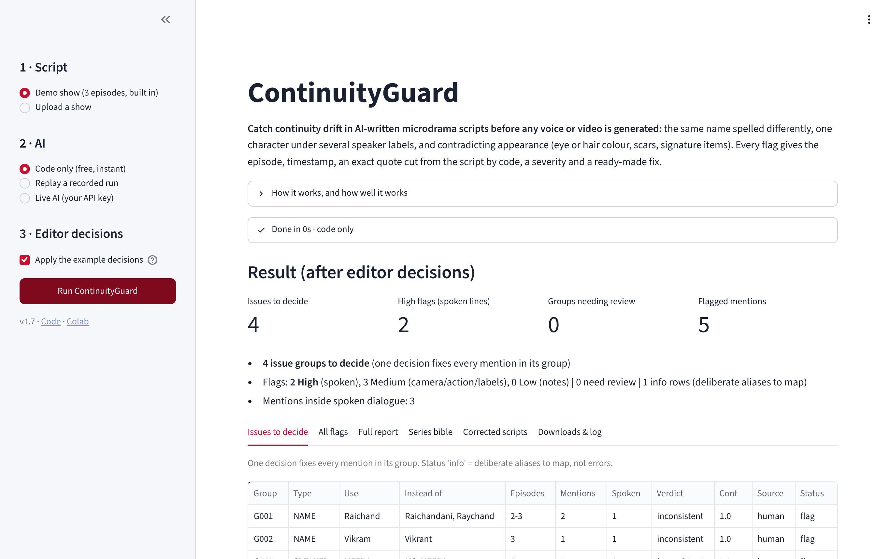
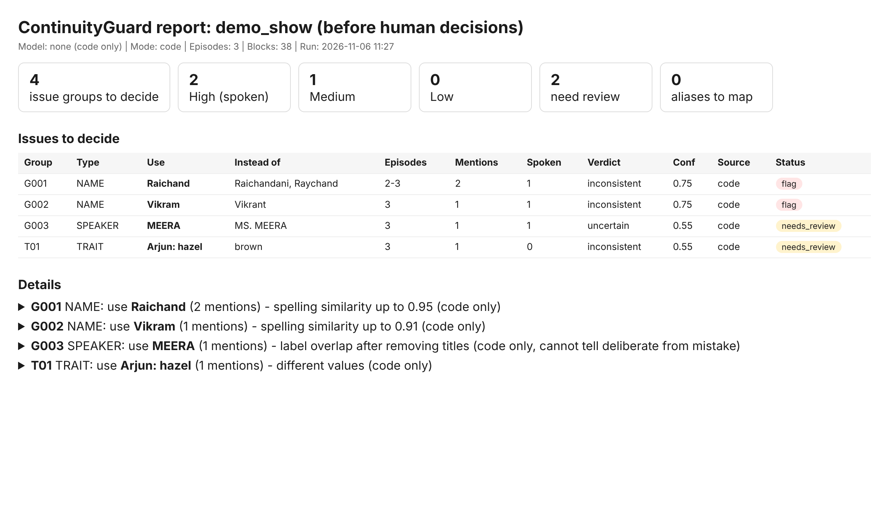

# ContinuityGuard

**Catch continuity drift in AI-written microdrama scripts before any video is generated.**

When a long series is written episode by episode by an AI model, names and details drift: a family's house gets a
new spelling every few episodes, one character appears under several speaker labels, eye colour changes between
close-ups. Each slip is cheap to fix in the script and expensive to fix after voice and video are generated.

ContinuityGuard reads a whole series and gives the script editor one report:

- **Names** spelled differently (people, families, places, companies, titles)
- **Speaker labels** that are the same character (and whether that is a mistake or a deliberate hidden identity)
- **Appearance** that contradicts itself (eye/hair colour, scars, signature items such as a ring)

Every flag has the episode, timestamp, an exact quote **cut from the script by code** (the model never writes
the evidence), a severity (spoken line = High, camera/action = Medium, notes = Low) and a ready-made fix.
Once the editor confirms decisions, it writes corrected scripts plus a diff, and a **series bible** whose
short "continuity sheet" can be pasted into the next episode's writing prompt to prevent drift.

**Try it:** [web app](https://continuity-guard-bn3pffh6zvwsfnnzbialqf.streamlit.app) (run the built-in demo or upload a show; no install) · [Colab notebook](https://colab.research.google.com/github/TheDeveloperAAA/continuity-guard/blob/main/ContinuityGuard.ipynb) (`Runtime -> Run all`). No key needed for code-only mode.





## How it works

```
script files ──> parser (code) ──> code checks ──────────────┐
                    │              (spelling variants,        │
                    │               label overlap, colours)   ├─> candidate issues ──> Judge (AI) ──> guards (code) ──> report
                    └──> Reader (AI, 10 episodes per call) ───┘    (code)              same or different?   quote check,
                         names + what they refer to,                                   mistake or deliberate? severity,
                         who each speaker is, stable traits                            canonical form          confidence
                                                                                                             │
                                          human decisions (YAML) ──> final report + fixed scripts + diff + series bible
```

| Step | Done by | Why |
|---|---|---|
| Parsing, timestamps, locations | Code | Exact and free |
| Spelling-variant grouping, label overlap, colour words | Code | Cheap, repeatable; catches most typos |
| What a name refers to, who a speaker is, traits behind "his/her" | AI Reader | Needs reading comprehension |
| Same or different? Mistake or deliberate? | AI Judge | Needs story context (e.g. a name hidden on purpose) |
| Quote and block checks, severity, thresholds | Code | The model cannot invent evidence |
| Final call on names | Human editor | Ambiguous cases are a story decision |

## Run it

**Web app:** https://continuity-guard-bn3pffh6zvwsfnnzbialqf.streamlit.app. Pick the demo show or upload a `.zip` of episode `.txt` files, then choose **Code only** (free, instant), **Replay a recorded run** (upload a `raw_outputs.zip`; no key) or **Live AI** (paste your own key; any OpenAI-compatible endpoint and model). You get the issues to decide, every flag with its quote and timestamp, the full report, the series bible, and corrected scripts when you add a decisions file. Run it locally with `pip install -r app/requirements.txt` and `streamlit run app/streamlit_app.py`.

**Colab (recommended):** open the notebook link above and run all cells. You don't need to upload anything; it checks the bundled demo show.
To check a real show, put files in `/content/inputs/`. The notebook picks them up automatically:
- the episode `.zip`
- optionally a `raw_outputs.zip` from an earlier run, which replays that run's recorded model answers without a key
- optionally `golden*.json` and `decisions*.yaml`, for the evaluation and the patched scripts

Add `GEMINI_API_KEY` under Colab Secrets to run the AI live.

**Locally:**

```bash
pip install -r requirements.txt
export LLM_API_KEY=...                      # or GEMINI_API_KEY; omit and use --mode code
python run.py smoke                          # which models does this key reach?
python run.py check --input samples/demo_show --out outputs/demo
python run.py check --input my_show.zip --out outputs/my_show --decisions decisions.example.yaml
python run.py evaluate --input samples/demo_show_clean --out outputs/eval --clean samples/demo_show_clean
python -m pytest -q                          # tests (no key needed)
```

## Swap the model

Everything model-related is in `config.yaml` (`base_url`, `name`, `fallbacks`). Any OpenAI-compatible endpoint works:
Gemini (default), OpenAI, Anthropic's OpenAI-compatible endpoint, Groq, OpenRouter, or a local vLLM/Ollama server.
From the command line: `--model NAME --base-url URL`. All prompts live in `prompts.yaml`.

## Outputs

| File | What it is |
|---|---|
| `05_ai_report.html/.md`, `05_ai_flags.csv` | Report before any human decision (code + AI only) |
| `06_final_report.*`, `06_final_flags.csv` | Report after the editor's decisions |
| `07_series_bible.md/.json`, `07_prompt_block.txt` | Canonical names, characters, labels, traits; paste-ready continuity sheet |
| `08_fixed_scripts/`, `08_fixes.diff` | Scripts with confirmed fixes applied, and the exact changes |
| `02_reader_items.json`, `04_judge_decisions.json`, `llm_calls/` | Every model request and reply, unedited |
| `00_run_manifest.json` | Model, settings, token usage, timing |

## How we know it works

`python run.py evaluate` runs, in priority order: the show (full and code-only), a **frozen set of planted errors**
(six types, chosen by a seeded script before any tuning; relationship flips are deliberately out of scope to show
limits), a **one-prompt AI baseline** for comparison, a separate tuning set, and a **clean control** script that
should raise no flags. Scores are per error type. A private "golden set" of real issues can be added with `--golden`.

## Limits

- Checks names, speaker identities and stable appearance only; not plot logic, timelines or relationships.
- Code-only name extraction relies on capital letters, so names in scripts like Devanagari are found by the AI step only.
- Ambiguous cases (a nickname, a cover name) go to "needs review"; the editor decides.
- On free API tiers, inputs may be used by the provider; production use should go through a paid or enterprise endpoint.

## Repo layout

```
cguard/        parser, rules (code checks), ai (Reader/Judge/baseline), issues (candidates, flags, fixes, bible),
               report, evaluate (planted errors, scoring), suite, llm (client), mock (offline stand-in)
samples/       demo show (3 original episodes) with an answer key, and a clean version
run.py         command line;  ContinuityGuard.ipynb  Colab notebook
config.yaml    model and thresholds;  prompts.yaml  all prompts
```
